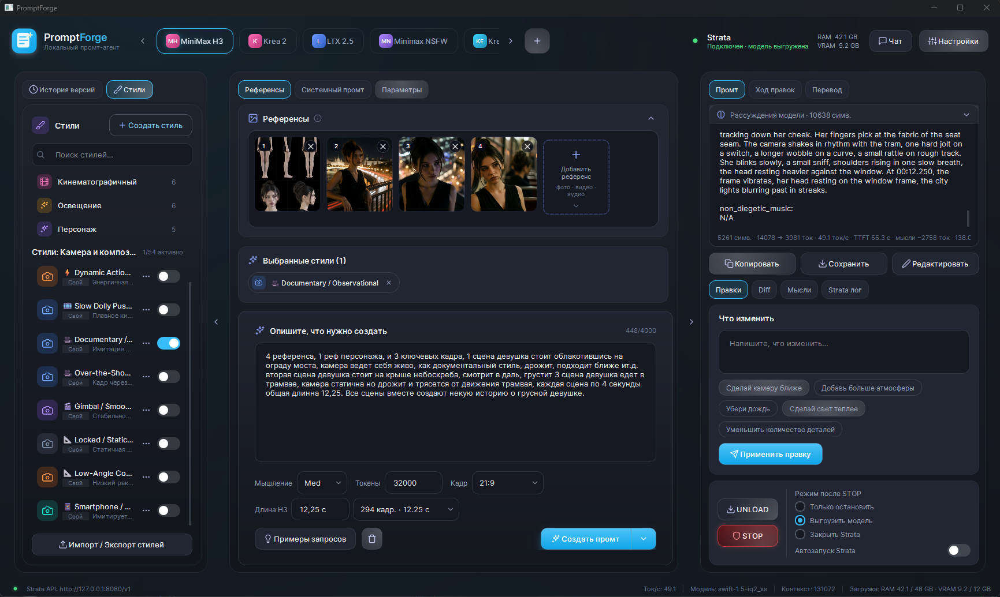
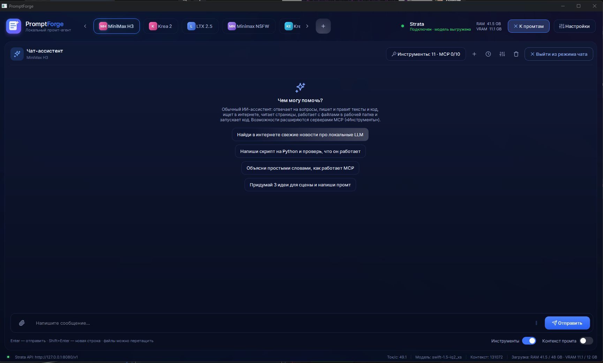

<div align="center">

# ⚒️ PromptForge

**Локальная мастерская промтов для генеративных моделей**
*A local prompt workstation for image & video models, powered by your own LLM.*


-41CD52?logo=qt&logoColor=white)


</div>

PromptForge — десктопное приложение, которое превращает короткую идею, референсы и набор стилей в готовый
промт для генеративной модели (в комплекте пресеты MiniMax H3, Krea 2, Krea Edit и LTX 2.5). Всё работает **локально**: текст пишет ваша
LLM, запущенная в [Strata](#требования) или любом другом сервере с OpenAI-совместимым API
(по умолчанию `http://localhost:8080/v1`). Облачные ключи не нужны.



---

## ✨ Возможности

### Студия промтов
- **Раскладка «Студия»**: слева история версий и стили, в центре референсы, системный промт и параметры,
  справа результат на всю высоту.
- **Пресеты моделей** — вкладки в шапке. Каждый пресет хранится в отдельном JSON в `data/models/`
  (системный промт, правила, vision). В комплекте: **MiniMax H3** (системный промт — `data/prompts/portable-prompt.md`),
  **Krea 2**, **Krea Edit**, **LTX 2.5**. Новый файл подхватывается без правки кода. Пресеты можно добавлять,
  импортировать, экспортировать и удалять (ПКМ по вкладке).
- **Референсы**: изображения, видео и аудио с описаниями. Картинки отправляются модели, если у пресета включён
  vision; видео и аудио передаются названием и описанием. Для MiniMax H3 картинки подписываются как `<Picture N>`.
- **Стили** — библиотека из ~50 стилей (плёнка, свет, камера и композиция…) с категориями, поиском, своими стилями,
  импортом/экспортом. Активные стили показываются чипами под референсами.
- **Системный промт** из текста или из файла `.md` / `.txt`. Переключатель **Просмотр / Редактор**: просмотр
  рендерит markdown (заголовки, таблицы, `code`), редактор — моноширинный, вставка без порчи таблиц.
  Модель всегда получает исходный текст.
- **Уровни рассуждений**: Выкл / Low / Med / High (`reasoning_effort`, мягкий бюджет токенов),
  живой счётчик «Думает N с · ~M ток».
- **Калькулятор длины MiniMax H3**: вводите секунды — получаете ближайшие допустимые значения
  по сетке `length = 17·k + 5` кадров при 24 fps (например, 277 = 11.54 с, 294 = 12.25 с).
  Выбранная длина уходит в запрос, а ответ проверяется на её упоминание.
- Быстрые параметры всегда под рукой: мышление, лимит токенов, соотношение сторон, длина H3, кнопка «Создать».
  Режимы создания: обычный, без референсов, новая сессия.

### Результат и правки
- Потоковый вывод, блок рассуждений модели, метаданные: токены prompt → completion, **ток/с**, **TTFT**, время.
- Бейдж «Обрезано по max_tokens» и кнопка «Лимит ×2».
- Нижние вкладки: **Правки** (быстрые правки текстом и чипами), **Diff** между версиями, **Мысли**, **Strata лог**.
- История версий каждой генерации, сравнение версий, ручное редактирование, сохранение в файл.
- **Перевод** готового промта на выбранный язык.
- Ток/с в строке состояния, загрузка RAM/VRAM.

### Чат-ассистент (Ctrl+L)



- Агентный цикл: модель сама вызывает инструменты и продолжает работу; ответ, рассуждения и вызовы идут потоком.
- Встроенные инструменты (без Node.js): поиск в сети (DuckDuckGo / SearXNG / Brave), чтение страниц,
  файлы рабочей папки, запуск Python и команд, калькулятор, дата/время.
  Запись и запуск кода — только после подтверждения.
- **MCP-серверы** (stdio, Streamable HTTP, SSE). Формат `config/mcp_servers.json` совместим с Claude Desktop / Cursor;
  в каталоге — Context7, Memory, Filesystem, Git, Playwright и др.
- Чаты сохраняются в SQLite; можно подмешать в контекст текущий запрос и промт.

### Управление Strata и ComfyUI
- Запуск Strata из приложения, автозапуск, **UNLOAD** (выгрузить модель из памяти) и **STOP**
  с выбором действия: только остановить / выгрузить модель / закрыть Strata. Автовыгрузка по простою.
- Интеграция с **ComfyUI** (`127.0.0.1:8188`): перед генерацией текста PromptForge ждёт, пока Comfy освободится,
  а когда Comfy начинает рендер — выгружает модель Strata, чтобы освободить VRAM.

### Интерфейс
- Тёмные темы, анимации (отключаются в настройках или переменной `PROMPTFORGE_REDUCED_MOTION=1`),
  интерфейс на русском и английском.

---

## 📋 Требования

| | |
|---|---|
| ОС | Windows 10/11 |
| Python | 3.12+ (проверено на 3.14) |
| Зависимости | `PySide6`, `requests` — см. [`requirements.txt`](requirements.txt) |
| LLM-сервер | **Strata** или любой OpenAI-совместимый сервер (llama.cpp server, Ollama и т.п.) на `localhost:8080/v1` |
| Опционально | ComfyUI; Node.js (`npx`) и/или [uv](https://docs.astral.sh/uv/) (`uvx`) для внешних MCP-серверов |

Для vision-референсов нужна мультимодальная модель на сервере.

## 🚀 Установка и запуск

```bat
git clone https://github.com/zeroleloushe/PromtForge.git PromptForge
cd PromptForge
copy config\config.example.json config\config.json
run.bat
```

`run.bat` при первом запуске создаёт `.venv`, ставит зависимости из `requirements.txt` и запускает `main.py`.
Вручную:

```bat
python -m venv .venv
.venv\Scripts\pip install -r requirements.txt
.venv\Scripts\python main.py
```

Затем: **Настройки → Strata** — укажите файл запуска Strata и адрес API, выберите пресет,
добавьте референсы и стили, опишите задачу и нажмите **«Создать промт»** (или Ctrl+Enter).

Сборка `.exe`: `build_exe.bat` (PyInstaller, onedir → `dist\PromptForge\`).

## ⚙️ Конфигурация

| Файл | Что внутри |
|---|---|
| `config/config.json` | Ваши настройки (в git не попадает). Шаблон — `config/config.example.json`. Если файла нет, используются значения по умолчанию. |
| `config/mcp_servers.json` | MCP-серверы для чата |
| `data/models/*.json` | Пресеты моделей |
| `data/prompts/*.md` | Системные промты из файлов (пути относительно корня проекта) |
| `data/styles/*.json` | Стили |

Основные ключи `config.json`:

- `strata.executable`, `strata.api_base` — запуск и адрес LLM-сервера;
- `strata.auto_start`, `strata.auto_unload`, `strata.after_stop` — поведение Strata;
- `generation.max_tokens` (32000), `generation.temperature`, `generation.thinking_level`;
- `generation.timeout` — обычные запросы; `generation.stream_timeout` (600 с) — пауза между чанками потока,
  чтобы длинные рассуждения не обрывались;
- `comfy.url`, `comfy.unload_strata_on_run` — связка с ComfyUI;
- `ui.language` (`ru`/`en`), `ui.theme`.

Пользовательские данные — история (`data/promptforge.db`), референсы (`data/references/`), логи (`logs/`) —
хранятся локально и исключены из репозитория.

## 🗂 Структура проекта

```
PromptForge/
├── main.py                 # точка входа
├── run.bat / build_exe.bat
├── requirements.txt
├── app/
│   ├── core/               # ContextBuilder, PromptEngine, AgentEngine, менеджеры моделей/стилей/референсов/истории,
│   │                       # переводчик, ComfyBridge, калькулятор H3 (h3.py)
│   ├── strata/             # клиент OpenAI-совместимого API (стриминг, отмена, unload), процесс, StrataManager
│   ├── mcp/                # MCP-клиент, встроенные инструменты, каталог, менеджер
│   ├── ui/                 # интерфейс PySide6: окно, панели, тема, анимации, просмотр markdown
│   ├── database/           # SQLite
│   └── utils/              # конфиг, пути, i18n (ru/en), логирование с маскировкой секретов
├── config/                 # config.example.json, mcp_servers.json
├── data/
│   ├── models/             # пресеты моделей (JSON)
│   ├── prompts/            # системные промты в .md (portable-prompt.md для MiniMax H3)
│   └── styles/             # стили (JSON)
└── docs/screenshots/
```

## 📄 Лицензия

Лицензия пока не выбрана. До её появления все права принадлежат автору.
Чтобы разрешить использование и доработки, добавьте файл `LICENSE` (например, MIT).
